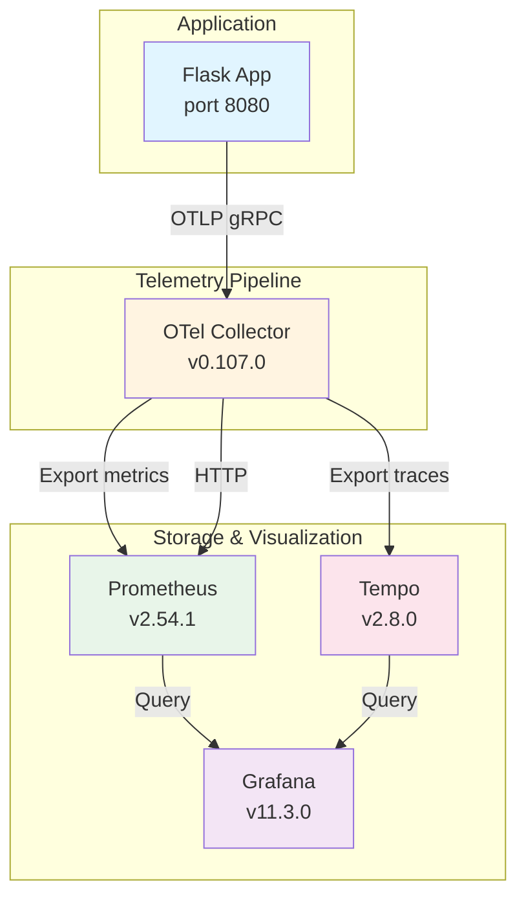

# OpenTelemetry Observability Home Lab

## Goal & Platform Problem

This project implements a complete observability stack for a home lab environment using OpenTelemetry standards. The goal is to demonstrate SRE practices with RED metrics (Rate, Errors, Duration), SLO/SLI monitoring, and distributed tracing in a self-hosted infrastructure.

**Key Problems Solved:**
- Traditional monitoring lacks context across service boundaries
- Error rates and latency thresholds are reactive, not proactive
- SLO violations are discovered too late to prevent customer impact
- No unified view of system health across metrics, traces, and logs

**SRE Focus Areas:**
- **RED Metrics** as the gold standard for service health
- **SLO/SLI** error budget tracking for proactive alerting
- **Distributed Tracing** to identify latency bottlenecks
- **Zero-secrets** configuration for secure home lab deployment

## Architecture



## Stack & Design Decisions

| Component | Version | Role | Design Rationale |
|-----------|---------|------|------------------|
| Flask | 3.0.0 | Application | Simple Python web framework for demo |
| OpenTelemetry SDK | 1.25.0 | Instrumentation | Vendor-neutral telemetry standards |
| OTel Collector | 0.107.0 | Collector | Centralized telemetry pipeline |
| Tempo | 2.8.0 | Trace storage | Native OTel trace backend |
| Prometheus | 2.54.1 | Metrics storage | Time-series for RED metrics |
| Grafana | 11.3.0 | Visualization | Unified dashboard for SLOs |

**Key Decisions:**
1. **OTLP gRPC** for efficient telemetry ingestion
2. **Batch processor** in collector for throughput optimization
3. **Local Tempo storage** for simplicity in home lab
4. **SLO-based alerting** on error budget burn rate
5. **Non-root containers** following security best practices

## Quickstart & Local Validation

### Prerequisites
- Docker Engine 24+
- Docker Compose v2+
- 4GB+ RAM

### Deploy Stack
```bash
# Validate configuration
make validate

# Start all services
make up

# Generate sample traffic
make traffic

# Verify telemetry
make verify
```

### Access Points
| Service | URL | Credentials |
|---------|-----|-------------|
| Application | http://localhost:8080 | N/A |
| Prometheus | http://localhost:9090 | N/A |
| Tempo | http://localhost:3200 | N/A |
| Grafana | http://localhost:3000 | admin/admin |

### Endpoints
| Endpoint | Description |
|----------|-------------|
| `/healthz` | Health check (200 OK) |
| `/` | Root endpoint |
| `/slow` | Simulates 1.5s delay |
| `/error` | Returns 500 error |
| `/chain` | Creates nested spans |

## Evidence

| File | Description |
|------|-------------|
| `evidence/01-compose-validate.txt` | Docker Compose validation output |
| `evidence/02-stack-up-health.txt` | Stack up and health check |
| `evidence/03-traffic-and-prometheus-metrics.txt` | Traffic generation and Prometheus metrics |
| `evidence/04-tempo-traces.txt` | Tempo trace query |
| `evidence/05-cleanup.txt` | Cleanup output |
| `evidence/06-ci-run.txt` | GitHub Actions CI run output |

## Failure Modes & Troubleshooting

### ModuleNotFoundError: No module named 'pkg_resources'
Python 3.12 with `opentelemetry-instrumentation-flask==0.46b0` failed because `setuptools>=82` removed `pkg_resources`. Pin `setuptools>=65.5.0,<81` in `app/requirements.txt`.

### Host Port 4317 Collision
Both `tempo` and `otel-collector` exposed host port `4317:4317` in `docker-compose.yml`. Removed the host port mapping from `tempo`; the collector reaches Tempo over the internal Docker network at `tempo:4317`.

### Tempo gRPC Port Collision
Tempo's `server.grpc_listen_port: 4317` collided with its OTLP gRPC receiver on `4317`. Changed `server.grpc_listen_port: 9095` in `tempo.yaml`.

### Service Not Starting
```bash
# Check logs
docker compose logs -f <service>

# Common issues:
# - Port conflicts: Change ports in docker-compose.yml
# - Permission denied: Ensure Docker user has proper permissions
# - Network issues: Verify docker network exists
```

### No Metrics/Traces
```bash
# Verify OTel Collector is receiving
docker compose exec otel-collector otelcol --version

# Check application environment
docker compose exec app env | grep OTEL

# Verify connectivity
docker compose exec app nc -zv otel-collector 4317
```

### SLO Alerts Not Firing
```bash
# Check Prometheus rules
curl -s http://localhost:9090/api/v1/rules | jq

# Verify alert expression
curl -s "http://localhost:9090/api/v1/query?query=high_error_rate" | jq

# Check notification configuration in Grafana
```

### High Memory Usage
```bash
# Increase swap or reduce retention
# Prometheus: --storage.tsdb.retention.time=30m
# Tempo: adjust compaction settings
# Reduce batch sizes in otel-collector.yaml
```

## Cost & Cleanup

### Resource Estimates (Home Lab)
| Component | CPU | Memory | Storage | Notes |
|-----------|-----|--------|---------|-------|
| App | 0.1 | 128MB | 50MB | Flask + dependencies |
| OTel Collector | 0.2 | 256MB | 100MB | Batch processing |
| Prometheus | 0.3 | 512MB | 2GB | 1h retention |
| Tempo | 0.2 | 256MB | 500MB | Local storage |
| Grafana | 0.1 | 256MB | 100MB | Dashboard server |
| **Total** | ~1.0 | ~1.4GB | ~2.9GB | |

### Cleanup
```bash
# Stop and remove everything
make clean

# Or manually
docker compose down -v
docker volume rm 51-opentelemetry-observability-home-lab_tempo-data
docker volume rm 51-opentelemetry-observability-home-lab_grafana-data
```

### Cost Optimization Tips
1. **Reduce retention**: Set Prometheus `--storage.tsdb.retention.time=1h`
2. **Disable unused features**: Tempo write_queue can be disabled
3. **Container limits**: Add memory/CPU limits in docker-compose.yml
4. **Off-peak only**: Run stack only during testing hours

---

*Built with SRE principles: Monitoring is code, dashboards are docs, alerts are SLAs.*
